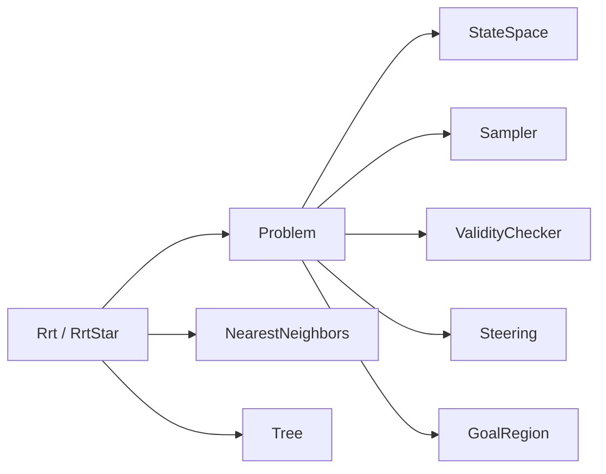

# Design

`sampling-planning` is a **motion planning** crate: sampling-based planners
for continuous configuration spaces. It is not a task planner. The name
`motion-planning` was taken on crates.io.

## Scope

| Module | Planners |
| --- | --- |
| `trees` | RRT, RRT*, Informed RRT*, RRT-Connect; later RRT# |
| `informed` | later: BIT*, AIT*, ABIT*, EIT* |
| `roadmaps` | PRM, PRM*, lazy PRM, FMT*; later SPARS, SPARS2, BFMT* |
| `kinodynamic` | SST, SST*; later KPIECE |

FMT* and BFMT* build a roadmap-like sample set and march over it, so they
live in `roadmaps` until they need their own module.

Shared infrastructure sits at the crate root: state spaces, samplers,
validity checking, nearest-neighbor structures, steering, goals and the
problem definition, plus path shortcutting. A module is created only when its
first planner lands; `informed` does not exist yet.

## Traits

All strategy traits take the state space by reference (`&Sp`) where they need
a metric or interpolation. They never own it, so one space instance is
shared by the planner, the nearest-neighbor structure, the steering function
and the validity checker.



### `StateSpace`

```rust
pub trait StateSpace {
    type State: Clone;
    fn dimension(&self) -> usize;
    fn distance(&self, from: &Self::State, to: &Self::State) -> f64;
    fn interpolate(&self, from: &Self::State, to: &Self::State, t: f64) -> Self::State;
}
```

- `distance` is a metric. Planners use it both as the nearest-neighbor
  metric and as the path cost. A separate cost objective (clearance, energy)
  is a later addition; it will be a new trait, not a change to this one.
- `interpolate` is the geodesic at fraction `t` in `[0, 1]`.
- `dimension` feeds the RRT*/PRM* connection radius.
- Bounds are not part of the space. The sampler defines where states come
  from, the validity checker defines where they may be.

Milestone 1 ships `Euclidean<N>` with state `[f64; N]`. Later spaces: SO(2),
SE(2), SE(3) and compound spaces.

### `Sampler`

```rust
pub trait Sampler<S> {
    fn sample<R: Rng + ?Sized>(&mut self, rng: &mut R) -> S;
}
```

`&mut self` lets deterministic low-discrepancy samplers (Halton) and informed
samplers (ellipsoid around the best path) keep state. The RNG is passed in,
never owned, so one seeded RNG drives a whole planning run. Milestone 1 ships
`UniformBox<N>`.

### `ValidityChecker`

```rust
pub enum Validity { Valid, Invalid, Unknown }

pub trait ValidityChecker<Sp: StateSpace> {
    fn check_state(&self, state: &Sp::State) -> Validity;
    fn check_motion(&self, space: &Sp, from: &Sp::State, to: &Sp::State) -> Validity;
}
```

- The result is three-valued so that a checker that cannot decide (a
  reachable-set over-approximation that intersects an obstacle, a timeout, a
  numerically fragile test) can say so instead of guessing.
- **Planners accept only `Valid`.** `Unknown` is rejected like `Invalid`.
  This is the conservative default the robust planning layer needs: a test
  that fails to prove safety never yields a safe edge.
- `check_motion` covers the whole segment from `from` to `to`, including
  `to`. `from` is assumed to be valid already (it is a tree node).
- `Validity::and` combines results: `Invalid` dominates `Unknown`, which
  dominates `Valid`.
- The helper `discretized_motion` implements `check_motion` by checking
  interpolated states at a fixed resolution. It is not a proof; a checker
  with exact geometry overrides `check_motion`.

A single trait with both methods keeps the planner bounds short. Splitting it
into state and motion traits is possible later if a consumer needs only one.

Not done yet: a policy knob that accepts `Unknown`. Nobody needs it; add it
on the planner config when someone does.

### `NearestNeighbors`

```rust
pub trait NearestNeighbors<Sp: StateSpace> {
    fn insert(&mut self, id: usize, state: Sp::State);
    fn nearest(&self, space: &Sp, query: &Sp::State) -> Option<usize>;
    fn within_radius(&self, space: &Sp, query: &Sp::State, radius: f64, out: &mut Vec<usize>);
    fn len(&self) -> usize;
}
```

Ids are the planner's node ids, so the structure needs no back-pointers.
Ties break toward the earliest inserted state, which keeps runs reproducible.
`within_radius` writes into a caller buffer to avoid an allocation per
iteration.

Shipped: `LinearScan` (any metric) and `KdTree<N>` (only for `Euclidean<N>`).
The k-d tree compares the same `distance` values as the linear scan and pads
its pruning bound by a relative `1e-9`, so both return identical ids; a test
cross-checks them on inputs full of exact ties. It is incremental and never
rebalances, which is fine for random insertions.

`RemovableNeighbors: NearestNeighbors` adds `remove(id)` as a separate trait,
so only planners that need deletion (SST's active set) require it. Both
structures implement it (the k-d tree with tombstones).

Later: k-nearest queries (for k-nearest RRT*/PRM*) and GNAT for general
metrics.

### `Steering`

```rust
pub trait Steering<Sp: StateSpace> {
    fn steer(&self, space: &Sp, from: &Sp::State, toward: &Sp::State) -> Sp::State;
}
```

Milestone 1 ships `StraightLine { max_step }`: go toward the target, at most
`max_step` far. Kinodynamic planners need steering that returns controls and
a duration as well as the reached state; that becomes a separate
`Propagator` trait in `kinodynamic`, not an extension of this one.

### Goals and problems

`GoalRegion { center, tolerance }` accepts every state within `tolerance` of
`center`. Goal bias samples `center`. A general goal trait (goal sets,
sampled goal states, predicates) comes when a planner needs more than a
ball.

`Problem` bundles space, sampler, checker, steering, start and goal. Planners
own the problem; they own their tree and nearest-neighbor structure too.

### Planners

Tree planners are stateful and incremental: `step(rng)` does one iteration,
`run(iterations, rng)` does many, `best_path()` returns the current best
solution. RRT also has `solve(max_iterations, rng)`, which stops at the first
solution. Incremental stepping makes anytime behaviour (RRT* cost over
iterations) observable without re-running.

RRT* uses the radius variant with
`r(n) = min(gamma * (ln n / n)^(1/d), eta)` (Karaman and Frazzoli 2011). The
planner takes `gamma` and the cap `eta` (`max_radius`, usually the steering
step) from the config; the cap keeps every edge within one steering step,
which matters for reachable-set edge checks. Asymptotic optimality needs
`gamma > (2 (1 + 1/d))^(1/d) (mu(X_free) / zeta_d)^(1/d)`, where `zeta_d` is
the volume of the unit `d`-ball; the docs on `RrtStarConfig` spell this out.
When a node is rewired, the costs of all its descendants are recomputed, so
the cost of every node, and the best solution cost, never increases.

Informed RRT* is a config flag (`RrtStarConfig::informed`). Once a solution
of cost `c` exists, samples with `d(start, x) + d(x, center) >= c + tolerance`
are rejected, up to `INFORMED_ATTEMPTS` draws per iteration. The tolerance
term keeps the set admissible for a ball goal. Rejection keeps the `Sampler`
trait unchanged and works in every space; direct sampling of the prolate
hyperspheroid would be faster when the set is thin but needs Euclidean
structure, so it waits for a dedicated sampler.

RRT-Connect roots a second tree at the goal center. Goal-tree edges are
traveled toward the root, so they are checked in that direction
(`check_state(new)`, then `check_motion(new, parent)`). The trees meet when a
steered state is at distance zero from its target, which requires `Steering`
to return the target itself when it can reach it.

### Roadmaps

`Prm` and `FmtStar` take space, sampler and checker directly instead of a
`Problem`: they have no steering, and `Prm` answers many start and goal
pairs. Edges are direct motions along `interpolate`.

- PRM uses a fixed radius, PRM* `gamma (ln n / n)^(1/d)` with
  `gamma > 2 (1 + 1/d)^(1/d) (mu / zeta_d)^(1/d)` (Karaman and Frazzoli 2011,
  Theorem 34). Queries attach the start and the goal center with the current
  radius and run Dijkstra (ties by `total_cmp`, then node id).
- Lazy PRM stores edges unchecked and checks the edges of each candidate
  path at query time. It returns the eager cost for the same samples.
- Roadmap edges are traveled both ways but checked once, from the older to
  the newer node; that assumes a symmetric `check_motion`.
  `check_both_directions` is the switch for directional checkers.
- FMT* follows Algorithm 2 of Janson et al. 2015 with
  `gamma > 2 (1/d)^(1/d) (mu / zeta_d)^(1/d)` (Theorem 4.1 with `eta = 0`).

### Kinodynamic planners

`Propagator` (control sampling, forward simulation, control dimension) and
`KinodynamicProblem` live in `kinodynamic`. SST propagates in fixed
integration steps and checks each step with `check_motion`. Its cost is the
total control duration, so solutions are `Trajectory` values (states plus
controls and durations), not `Path`. SST* shrinks both radii by `xi` after
epoch `j`, whose length is `(1 + ln j) xi^(-(d + l + 1) j) K_0` (Li et al.
2016, Algorithm 9). Inactive nodes stay in memory; only the active index
forgets them.

### Post-processing

`shortcut` (greedy, deterministic, drops states) and `shortcut_random`
(random cuts between points on the path) check motions in travel direction,
never return a costlier path, and take a `max_edge` bound because shortcuts
break the one-steering-step edge length.

## RNG strategy

Decision: depend on `rand_core` (0.10, `default-features = false`) and take
`R: rand_core::Rng + ?Sized` everywhere randomness is used.

- `rand_core` is the ecosystem's trait crate: no_std, no dependencies of its
  own, small. Users plug in any RNG they already have (PCG, xoshiro, ChaCha).
- Determinism comes from the caller: seed a `SeedableRng` and pass it. The
  crate never seeds itself or reads entropy.
- A tiny internal PRNG would avoid the dependency but force users onto our
  generator and re-invent seeding. It would also make it awkward to share one
  RNG with the rest of an application.
- Cost: `rand_core::Rng` is part of the public API, so `rand_core` major
  bumps (0.9 `RngCore` to 0.10 `Rng`) are breaking changes here too. The
  crate re-exports `rand_core` so users can name the exact version it uses.
- Uniform floats are built from the top 52 bits of `next_u64` (mantissa
  fill), so sampling is bit-for-bit reproducible across platforms and does not
  need `rand`'s distributions.
- Tests and examples use `rand_pcg` as a dev-dependency.

## `no_std` and `alloc`

The crate is `#![no_std]` and uses `alloc` (trees, nearest-neighbor
storage, paths). Nothing needs `std`.

Float math (`sqrt`, `ln`, `powf`) is not in `core`. Decision: always use
`libm`, no `std` feature.

- `libm` is pure Rust, no_std and has no dependencies.
- The same code runs on every target, so planner results for a fixed seed are
  bit-identical across platforms. `std`'s `ln`/`powf` call the platform libm,
  whose results differ in the last bit between platforms; that would break
  reproducibility tests.
- A `std` feature that switches to the platform math would buy a little speed
  and cost determinism plus a feature matrix. Revisit only if profiling shows
  float math matters, which is unlikely next to collision checks.

## Testing strategy

- Unit tests next to each building block: sampler stays in bounds, steering
  respects `max_step`, nearest-neighbor tie-breaking and radius queries,
  `Validity::and`.
- Integration tests in `tests/` on a 2D world with box obstacles, always
  with a fixed seed:
  - every returned path starts at the start, ends in the goal region, and
    every segment passes `check_motion` as `Valid`;
  - every state stays inside the sampling box;
  - RRT* best cost is non-increasing over iterations;
  - a checker that answers `Unknown` in a region keeps paths out of it.
- Later: property tests (proptest) over random seeds and worlds, and
  benchmarks against OMPL's reference numbers on standard problems.

## References

- S. M. LaValle. *Rapidly-exploring random trees: A new tool for path
  planning.* TR 98-11, Iowa State University, 1998.
- S. M. LaValle and J. J. Kuffner. *Randomized kinodynamic planning.* IJRR
  20(5), 2001.
- S. Karaman and E. Frazzoli. *Sampling-based algorithms for optimal motion
  planning.* IJRR 30(7), 2011. (RRT*, PRM*, radius bounds.)
- L. E. Kavraki, P. Švestka, J.-C. Latombe and M. H. Overmars. *Probabilistic
  roadmaps for path planning in high-dimensional configuration spaces.* IEEE
  T-RA 12(4), 1996.
- L. Janson, E. Schmerling, A. Clark and M. Pavone. *Fast marching tree.*
  IJRR 34(7), 2015.
- J. D. Gammell, T. D. Barfoot and S. S. Srinivasa. *Batch Informed Trees
  (BIT\*).* IJRR 39(5), 2020.
- Y. Li, Z. Littlefield and K. E. Bekris. *Asymptotically optimal
  sampling-based kinodynamic planning.* IJRR 35(5), 2016. (SST, SST*.)

## Milestones

1. **Foundations and RRT/RRT\*** (done): traits above, `Euclidean<N>`,
   `UniformBox<N>`, `LinearScan`, `StraightLine`, `GoalRegion`, RRT and RRT*
   with goal bias, 2D obstacle example, integration tests.
2. **Roadmaps:** PRM, PRM*, lazy PRM and the k-d tree are done; k-nearest
   queries are open.
3. **Informed trees:** rejection-based informed sampling and RRT-Connect are
   done; direct ellipsoid sampling, RRT#, BIT*, then AIT*/EIT* are open.
4. **FMT\*/BFMT\*:** FMT* is done, BFMT* is open.
5. **Kinodynamic:** `Propagator`, SST and SST* are done, KPIECE is open.
6. **More spaces:** SO(2), SE(2), SE(3), compound spaces.

## Cross-crate needs

- `robust-planning` will reuse the RRT machinery with reachable-set
  (polyzonotope) edge checks. It plugs in through `ValidityChecker` and
  relies on `Unknown` being rejected. It will likely also need steering that
  returns controls (milestone 5 `Propagator`), and node data beyond a state
  (the reachable set at the node). The tree may need a generic payload per
  node for that; decide when `robust-planning` starts.
- No Cargo dependency on `polyzonotope` or `polyzonotope-reach` here.
- No need for `search-core` yet: none of these traits is shared with another
  crate today.

## Open questions

- Should `Validity` live in a shared crate so `polyzonotope-reach` can return
  it directly? Today `robust-planning` would map its own result to it.
- Cost objectives other than path length: separate trait, or a cost function
  on `Problem`?
- `f64` only, or generic over the scalar (`f32` for embedded targets)?
- PRM checks roadmap edges in one direction by default. Should directional
  checking be the default instead (correct for reachable sets, twice the
  checks for everyone else)?
- SST frees nothing; should inactive leaves be dropped (needs node removal
  from the tree and stable ids)?
