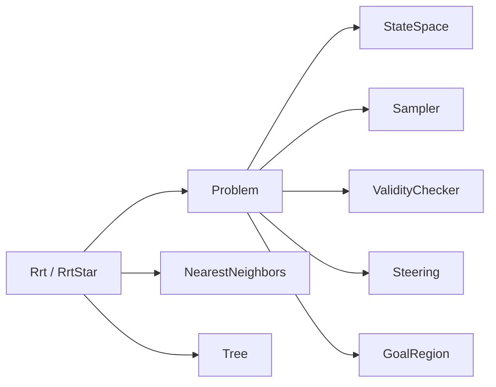

# Design

`sampling-planning` is a **motion planning** crate: sampling-based planners
for continuous configuration spaces. It is not a task planner. The name
`motion-planning` was taken on crates.io.

## Scope

| Module | Planners |
| --- | --- |
| `trees` | RRT, RRT*, RRT*-k, Informed RRT*, RRT#, RRT-Connect |
| `informed` | BIT*, AIT*; later ABIT*, EIT* |
| `roadmaps` | PRM, PRM*, k-nearest PRM*, lazy PRM, SPARS, SPARS2, FMT*, BFMT* |
| `kinodynamic` | SST, SST*, KPIECE |

FMT* and BFMT* build a roadmap-like sample set and march over it, so they
live in `roadmaps` until they need their own module.

Shared infrastructure sits at the crate root: state spaces, samplers,
validity checking, nearest-neighbor structures, steering, goals and the
problem definition, plus path shortcutting.

## Traits

All strategy traits take the state space by reference (`&Sp`) where they need
a metric or interpolation. They never own it, so one space instance is
shared by the planner, the nearest-neighbor structure, the steering function
and the validity checker.



### `StateSpace`

```rust
pub trait StateSpace {
    type State: Clone;
    fn dimension(&self) -> usize;
    fn distance(&self, from: &Self::State, to: &Self::State) -> f64;
    fn interpolate(&self, from: &Self::State, to: &Self::State, t: f64) -> Self::State;
}
```

- `distance` is the shortest-motion length from `from` to `to`: non-negative,
  zero for equal states, triangle inequality, and symmetric except for
  `Dubins`. Forward tree planners (RRT, RRT*, RRT#, SST) always measure from a
  tree node to the target, so they accept asymmetric distances; PRM (one cost
  per edge), RRT-Connect's goal tree, FMT* and `KdTree` need symmetry.
  Planners use it both as the nearest-neighbor metric and as the path cost. A separate cost objective (clearance, energy)
  is a later addition; it will be a new trait, not a change to this one.
- `interpolate` is the geodesic at fraction `t` in `[0, 1]`.
- `dimension` feeds the RRT*/PRM* connection radius.
- Bounds are not part of the space. The sampler defines where states come
  from, the validity checker defines where they may be.

Shipped spaces:

- `Euclidean<N>` with state `[f64; N]`, the only space with `is_euclidean`.
- `So2`: angles in radians, shortest-arc distance (at most `pi`) and
  interpolation, results wrapped into `[-pi, pi)`; sampler `UniformAngle`.
  `wrap_angle` and `angle_difference` are public helpers.
- `Se2(rotation_weight)` over the struct `Se2State { x, y, theta }`, not
  `[f64; 3]`, so Euclidean samplers and the k-d tree cannot be applied to it by
  accident. Distance `|dp| + w |dtheta|` (a weighted sum of metrics, so a
  metric; OMPL defaults to `w = 0.5`), straight position and short-arc heading
  interpolation. Sampler `UniformSe2` (position box, all headings).
- `Dubins(radius)` and `ReedsShepp(radius)` over `Se2State`, ported from
  OMPL's `DubinsStateSpace` and `ReedsSheppStateSpace` (Mark Moll). Distance
  is the shortest path length, interpolation walks that path
  (`DubinsPath` / `ReedsSheppPath`, public with their `Segment`s, and
  `candidates` lists every feasible word). Dubins searches all six words
  instead of OMPL's long-path classification; both pick the shortest.
  Reeds-Shepp evaluates OMPL's formulas 8.1 to 8.11 under time flip,
  reflection and backward symmetries (44 candidates over 18 word shapes) and
  wraps angles with a rounded quotient instead of `fmod`, which is about 20 %
  faster and equal up to rounding.
- All interpolations return `from` and `to` verbatim at `t = 0` and `t = 1`.
- `StraightLine` steering works for the car spaces as is: it interpolates the
  fraction `max_step / d` along the shortest path, and a prefix of a shortest
  path is a shortest path, so the steered state is `max_step` away. Tests
  check that `d(from, interpolate(t)) = t d(from, to)` for both.

Still open: SE(3) and compound spaces.

### `Sampler`

```rust
pub trait Sampler<S> {
    fn sample<R: Rng + ?Sized>(&mut self, rng: &mut R) -> S;
}
```

`&mut self` lets deterministic low-discrepancy samplers (Halton) and informed
samplers (ellipsoid around the best path) keep state. The RNG is passed in,
never owned, so one seeded RNG drives a whole planning run. The crate ships
`UniformBox<N>`, `UniformAngle` and `UniformSe2`.

### `ValidityChecker`

```rust
pub enum Validity { Valid, Invalid, Unknown }

pub trait ValidityChecker<Sp: StateSpace> {
    fn check_state(&self, state: &Sp::State) -> Validity;
    fn check_motion(&self, space: &Sp, from: &Sp::State, to: &Sp::State) -> Validity;
}
```

- The result is three-valued so that a checker that cannot decide (a
  reachable-set over-approximation that intersects an obstacle, a timeout, a
  numerically fragile test) can say so instead of guessing.
- **Planners accept only `Valid`.** `Unknown` is rejected like `Invalid`.
  This is the conservative default the robust planning layer needs: a test
  that fails to prove safety never yields a safe edge.
- `check_motion` covers the whole segment from `from` to `to`, including
  `to`. `from` is assumed to be valid already (it is a tree node).
- `Validity::and` combines results: `Invalid` dominates `Unknown`, which
  dominates `Valid`.
- The helper `discretized_motion` implements `check_motion` by checking
  interpolated states at a fixed resolution. It is not a proof; a checker
  with exact geometry overrides `check_motion`.

A single trait with both methods keeps the planner bounds short. Splitting it
into state and motion traits is possible later if a consumer needs only one.

Not done yet: a policy knob that accepts `Unknown`. Nobody needs it; add it
on the planner config when someone does.

### `NearestNeighbors`

```rust
pub trait NearestNeighbors<Sp: StateSpace> {
    fn insert(&mut self, id: usize, state: Sp::State);
    fn nearest(&self, space: &Sp, query: &Sp::State) -> Option<usize>;
    fn within_radius(&self, space: &Sp, query: &Sp::State, radius: f64, out: &mut Vec<usize>);
    fn k_nearest(&self, space: &Sp, query: &Sp::State, k: usize, out: &mut Vec<usize>);
    fn len(&self) -> usize;
}
```

Ids are the planner's node ids, so the structure needs no back-pointers.
Ties break toward the earliest inserted state, which keeps runs reproducible.
`within_radius` and `k_nearest` write into a caller buffer to avoid an
allocation per iteration. `k_nearest` returns ids closest first, equal
distances by insertion order; the same order decides the cut at the `k`-th
place. Both structures select through one bounded max-heap type, so they agree
on every tie.

Shipped: `LinearScan` (any metric) and `KdTree<N>` (only for `Euclidean<N>`).
The k-d tree compares the same `distance` values as the linear scan and pads
its pruning bound by a relative `1e-9`, so both return identical ids; a test
cross-checks them on inputs full of exact ties, and another on random
insert, remove and re-insert sequences. It is incremental, which is fine for
random insertions; `KdTree::rebalance` rebuilds it balanced (median splits)
after sorted bulk insertions.

`RemovableNeighbors: NearestNeighbors` adds `remove(id)` as a separate trait,
so only planners that need deletion (SST's active set) require it. Both
structures implement it. The k-d tree finds the node through an id map
(`BTreeMap`, alloc only), marks it removed, and rebuilds balanced over the live
nodes once removed nodes outnumber live ones (and number at least 16), so
removal is `O(log n)` amortized and memory tracks the live count. A rebuild
keeps the relative insertion order, which is the tie-break rank; a re-inserted
id counts as the newest node, as in `LinearScan`.

Later: GNAT for general metrics.

### `Steering`

```rust
pub trait Steering<Sp: StateSpace> {
    fn steer(&self, space: &Sp, from: &Sp::State, toward: &Sp::State) -> Sp::State;
}
```

The crate ships `StraightLine { max_step }`: go toward the target, at most
`max_step` far. Kinodynamic planners need steering that returns controls and
a duration as well as the reached state; that becomes a separate
`Propagator` trait in `kinodynamic`, not an extension of this one.

### Goals and problems

`GoalRegion { center, tolerance }` accepts every state within `tolerance` of
`center`. Goal bias samples `center`. A general goal trait (goal sets,
sampled goal states, predicates) comes when a planner needs more than a
ball.

`Problem` bundles space, sampler, checker, steering, start and goal. Planners
own the problem; they own their tree and nearest-neighbor structure too.

### Planners

Tree planners are stateful and incremental: `step(rng)` does one iteration,
`run(iterations, rng)` does many, `best_path()` returns the current best
solution. RRT also has `solve(max_iterations, rng)`, which stops at the first
solution. Incremental stepping makes anytime behaviour (RRT* cost over
iterations) observable without re-running.

RRT* uses the radius variant with
`r(n) = min(gamma * (ln n / n)^(1/d), eta)` (Karaman and Frazzoli 2011). The
planner takes `gamma` and the cap `eta` (`max_radius`, usually the steering
step) from the config; the cap keeps every edge within one steering step,
which matters for reachable-set edge checks. Asymptotic optimality needs
`gamma > (2 (1 + 1/d))^(1/d) (mu(X_free) / zeta_d)^(1/d)`, where `zeta_d` is
the volume of the unit `d`-ball; the docs on `RrtStarConfig` spell this out.
RRT*-k (`RrtStarConfig::k_nearest`) uses the `ceil(k ln n)` nearest nodes
instead, with `k > 2^(d+1) e (1 + 1/d)` (Theorem 39; OMPL uses 1.1 times
this), and still drops neighbors beyond `eta`.
When a node is rewired, the costs of all its descendants are recomputed, so
the cost of every node, and the best solution cost, never increases.

Informed RRT* is a config flag (`RrtStarConfig::informed`). Once a solution
of cost `c` exists, targets come from the informed set
`d(start, x) + d(x, center) < c + tolerance`; the tolerance term keeps the set
admissible for a ball goal. Goal bias still applies.

- `Sampler::sample_informed(space, rng, start, goal, max_cost)` is a provided
  method that returns `None` by default. `UniformBox` overrides it: when the
  space reports `StateSpace::is_euclidean` (only `Euclidean<N>` does), it
  samples the `ProlateHyperspheroid` with the two foci and rejects samples
  outside the box, which is uniform over the intersection. The unit-ball
  sample is a normalized Box-Muller Gaussian vector scaled by `u^(1/N)`; the
  rotation onto the focal axis is a Householder reflection, enough because all
  conjugate radii are equal (Gammell et al. use an SVD for the general case).
- It declines without touching the RNG when the set is degenerate or at least
  as large as the box (then rejection from the box accepts more often), and
  gives up after `INFORMED_BOX_ATTEMPTS` samples outside the box.
- Declining falls back to rejection: up to `INFORMED_ATTEMPTS` draws per
  iteration. Declining without drawing keeps the random stream identical to
  pure rejection, so a run whose informed set covers the box is bit-identical
  to an uninformed one; a test pins this.
- `is_euclidean` is a provided method on `StateSpace` that defaults to
  `false`, so a custom space over `[f64; N]` with another metric never gets
  Euclidean ellipsoids.

RRT# (`RrtSharp`, Arslan and Tsiotras 2013) takes an `RrtStarConfig` and
uses the same extension and neighbor rule, but links each new vertex both ways
to its neighbors (RRG) and then replans instead of rewiring. Each vertex keeps
`g` (committed cost) and `lmc` (one-step lookahead); vertices with `lmc < g`
sit in a queue keyed by `lmc + h`, `h = max(0, d(x, center) - tolerance)`.
Replanning pops the cheapest key, commits `g = lmc` and relaxes the out-edges,
until the top key cannot beat the best goal vertex. The graph only grows and
edge costs are fixed, so costs only decrease and LPA*'s underconsistent case
never occurs. Edges are checked lazily, in travel direction, and at most once:
only when they would lower an `lmc`. A unit test compares the best cost after
every batch of iterations with Dijkstra over all eagerly checked graph edges.
The paper's secondary key `min(g, lmc)` is replaced by the vertex id.

RRT-Connect roots a second tree at the goal center. Goal-tree edges are
traveled toward the root, so they are checked in that direction
(`check_state(new)`, then `check_motion(new, parent)`). The trees meet when a
steered state is at distance zero from its target, which requires `Steering`
to return the target itself when it can reach it.

### Roadmaps

`Prm` and `FmtStar` take space, sampler and checker directly instead of a
`Problem`: they have no steering, and `Prm` answers many start and goal
pairs. Edges are direct motions along `interpolate`.

- PRM uses a fixed radius, PRM* `gamma (ln n / n)^(1/d)` with
  `gamma > 2 (1 + 1/d)^(1/d) (mu / zeta_d)^(1/d)` (Karaman and Frazzoli 2011,
  Theorem 34). The k-nearest variants connect a new node to its `k` nearest
  older nodes (fixed `k`, or `ceil(k ln n)` with `k > e (1 + 1/d)` for
  k-nearest PRM*, Theorem 35). Queries attach the start and the goal center with the
  current rule and run Dijkstra (ties by `total_cmp`, then node id); the
  direct start-to-center motion is tried when the center is within the
  start's reach (the radius, or the distance of its `k`-th neighbor).
- Lazy PRM stores edges unchecked and checks the edges of each candidate
  path at query time. It returns the eager cost for the same samples.
- Roadmap edges are traveled both ways but checked once, from the older to
  the newer node; that assumes a symmetric `check_motion`.
  `check_both_directions` is the switch for directional checkers.
- FMT* follows Algorithm 2 of Janson et al. 2015 with
  `gamma > 2 (1/d)^(1/d) (mu / zeta_d)^(1/d)` (Theorem 4.1 with `eta = 0`).
- BFMT* (Starek et al. 2015, arXiv 1507.07602) shares FMT*'s batch and
  wavefront code (`roadmaps/march.rs`): a start tree marches outward, a goal
  tree inward from the goal center, and they swap after every expansion unless
  the other wavefront is empty. A newly connected node held by both trees is a
  connection; the cheapest is kept, and so is any start-tree node inside the
  goal region. `Termination::Optimal` (default, the paper's best-path
  criterion and OMPL's default) stops once the node just expanded was already
  expanded by the other tree; `Termination::FirstMeeting` stops at the first
  expansion that finds a connection (Algorithm 1 as printed). Goal-tree edges
  are checked child to parent, so directional checkers stay sound. The radius
  bound is the paper's `4 (1/d)^(1/d) (mu / zeta_d)^(1/d)` (Theorem 4.1);
  OMPL uses FMT*'s factor 2. Algorithm 3 (inserting fresh samples when a
  wavefront dies) is not implemented: a dead batch returns no path, like
  FMT*.

### Batch-informed planners

`BitStar` follows Algorithms 1 to 3 of Gammell, Barfoot and Srinivasa 2020
(arXiv 1707.01888): vertex queue by `g + h_hat` (ties by `g`), edge queue by
`g + c_hat + h_hat`, then `g + c_hat`, then `g`; a batch ends when the best
edge cannot improve the solution, then Prune (Algorithm 3: drop samples with
`f_hat >= c`, remove vertices with `f_hat > c` or `g + h_hat > c` in order of
`g`, recycle those with `f_hat < c` as fresh samples) and a new informed
batch. Heuristics are `g_hat = d(start, x)`, `h_hat = max(0, d(x, center) -
tolerance)`, `c_hat = d`; the goal center is the first sample, any vertex in
the goal region is a solution. Like RRT* it takes space, sampler, checker,
start and goal directly, since it needs no steering.

- The radius is `min(gamma (ln q / q)^(1/d), max_radius)` with
  `q = |V| + |X_unconn| - m`, or `ceil(k ln q)` nearest; the bounds are the
  paper's eqs. 1 and 2. The paper takes the smaller of the free and the
  informed volume in eq. 1; the crate keeps the user's `gamma` (free volume),
  which is admissible but uses larger neighborhoods.
- Batches come from `Sampler::sample_informed`, falling back to rejection,
  and keep only valid states with `f_hat < c_best`.
- A rewiring lowers the costs of a subtree and makes queue keys stale; both
  heaps are re-keyed before the next pop, as OMPL does.
- Pruned states stay in the node arena (marked) until the planner is dropped.

`AitStar` follows Algorithms 2 to 6 of Strub and Gammell 2020 (arXiv
2002.06599): BIT*'s batches, pruning, radius and informed sampling (shared
code in `informed/batch.rs` and `informed/queues.rs`), but no vertex queue.
The forward search expands vertices straight into an edge queue keyed
`(g_F + c_hat + h_con, g_F + c_hat, g_F)`, where `h_con` comes from a reverse
search: LPA* from the goal states (the goal center and every sample in the
goal region) over the batch's graph with `c_hat` costs and no collision
checks, focused by `g_hat = d(start, x)`. An edge the forward search finds
invalid is removed from that graph (`update_heuristic`) and LPA* repairs the
cost-to-go incrementally.

- The graph is fixed per batch: RGG neighbors, symmetrized (k-nearest is
  not symmetric, LPA* needs both directions), plus the forward-tree edges
  kept from earlier batches, minus invalid edges. Invalid edges are stored
  directed (the travel direction that was checked), so directional checkers
  stay sound; the paper and OMPL blacklist both directions.
- Two suspected typos in the paper, resolved against OMPL's `AITstar.cpp`:
  Algorithm 6 line 1 "x != x_init" is "x not in X_goal" (OMPL's
  `updateReverseSearchVertex` returns early on goals); Algorithm 5's stopping
  rule (lines 10 to 12, with the printed "<" on line 11) is replaced by
  OMPL's edge-based rule: pause the reverse search once the best forward
  edge's child is consistent (`h_con == h_exp`, two-sided) and the edge's
  first key is below the reverse queue's. Sound because `g_hat` is
  consistent, so an edge's first key bounds its child's LPA* key from above.
- Forward keys follow `h_con` (each state lists its queued incoming edges,
  as OMPL does); a rewiring re-keys the whole queue, like BIT*.
- The neighbor updates use the optimized LPA* form (a lowered `h_exp` only
  offers its own route, a raised one only re-evaluates neighbors that used
  it); the results equal Algorithm 6's.
- A new batch restarts the reverse search from the goals, as OMPL does. An
  invalid edge is repaired by LPA* (`update_state` of its source), as in the
  paper; OMPL instead invalidates the reverse branch below it.
- Pruning uses the geometric `h_hat`, not `h_con`: `h_con` is a cost over the
  current graph and not admissible for denser future batches.
- A batch ends at the first edge that cannot beat the incumbent. When the
  batch's graph holds no better path (or none), that is the first edge, so
  every step starts a batch: up to `batch_size` new states plus one
  neighbor query per stored state for the graph snapshot (quadratic with
  `LinearScan`). In free space a run measured 134 batches and 10.5k samples
  in 500 steps; budget AIT* by batches, not steps, and use `KdTree`.

### Sparse roadmaps

`Spars2` ports OMPL's `SPARStwo` (Dobson and Bekris 2013): each valid sample
is tested for coverage, connectivity, interface and quality, in that order;
construction is complete after `max_failures` consecutive samples that change
nothing. Guards, undirected edges, union-find components and the multi-query
Dijkstra live in `roadmaps/sparse.rs`, shared with SPARS. Deviations from
OMPL, all documented in rustdoc: the quality test uses OMPL's midpoint
estimate but adds the interface-point path without smoothing; any change
resets the failure counter; near samples follow the geodesic toward a uniform
sample with a bounded number of attempts. Tests check coverage (98 % of
random valid states see a guard), the stretch bound against a dense PRM*
(`t c* + 4 Delta`), sparsity and that the quality criterion fires.

`Spars` ports OMPL's `SPARS` (Dobson and Bekris 2014), which keeps a dense
k-nearest PRM* graph `D` (`k = ceil(e (1 + 1/d) ln n)`) next to the sparse
one. Each dense node has a representative, the closest visible guard within
`sparse_delta` (ties by id); each guard keeps, per other guard, the list of
its dense nodes with a dense neighbor closer than `dense_delta` represented by
that guard (interface lists), and a non-interface list. Every new guard
re-assigns the dense nodes within `sparse_delta + dense_delta`, as OMPL's
`updateRepresentatives`. The per-sample criteria (coverage, connectivity,
interface with the dense vertex as the new guard, then the interface
neighborhood and `checkAddPath`), the loop nesting of `checkAddPath`
(`s_max` of the outer `v''` against `d_min` accumulated over the inner
`VPPs[0..=j]`) and the failure rule (incremented only when all four tests
fail; reset by new guards, the direct interface edge and the zero-length path
case) follow OMPL, so it is labelled SPARS. Deviations, all documented in
rustdoc:

- `addPathToSpanner` connects the first path state to `v'` and the last to
  `v''`; OMPL passes them swapped.
- When `q` itself is on the `v`/`v''` interface the dense path is `[q]`; OMPL
  pushes `q` in front of the previous best path.
- A missing interface neighbor (OMPL throws) skips the violation.
- Every sparse edge of a quality path is checked first; the path is skipped
  if one is invalid. OMPL adds them unchecked.
- `reduceVertices` (randomized) is replaced by the deterministic greedy
  `shortcut`.
- Dense paths come from Dijkstra with ties by id; one search per `v''`
  candidate finds the closest interface node, and its result is reused across
  the outer loop.
- Dense nodes without a visible guard have no representative and stay out of
  the lists until the coverage criterion covers them in the same step.
- Start and goal are not added as guards; queries connect them to visible
  guards (multi-query, like `Spars2`). Invalid samples are not failures.

OMPL's `s_max` ignores the paths it adds, so once many dense edges undercut
`dense_delta`, quality paths keep creating violations and construction
effectively never ends, even at the default stretch 3 (on the 10 x 10 slalom
with `sparse_delta = 2`: from `dense_delta` of about 0.085 at stretch 3, about
0.06 at stretch 1.2). The tests use `dense_delta = 0.05` (OMPL's default would
be 0.014), where both stretch 1.2 and 100 finish, and cap the sample count so
that a run that tips over fails instead of hanging. Tests check the representative
invariant (unit test), coverage, the stretch bound against a dense PRM*,
sparsity against the dense graph, tight versus loose stretch and
reproducibility.

### Kinodynamic planners

`Propagator` (control sampling, forward simulation, control dimension) and
`KinodynamicProblem` live in `kinodynamic`. SST propagates in fixed
integration steps and checks each step with `check_motion`. Its cost is the
total control duration, so solutions are `Trajectory` values (states plus
controls and durations), not `Path`. SST* shrinks both radii by `xi` after
epoch `j`, whose length is `(1 + ln j) xi^(-(d + l + 1) j) K_0` (Li et al.
2016, Algorithm 9). Inactive leaves are freed at once, and each ancestor that
becomes an inactive leaf in turn (Algorithm 6). Nodes live in an arena with
stable ids; freed ids are reused. The start and the current best goal node
are never freed, so the best trajectory survives even when its goal node goes
inactive; a replaced best goal node is freed once it is an inactive leaf.

KPIECE (`Kpiece`, Sucan and Kavraki) follows OMPL's `control::KPIECE1` with
one grid level over a user `Projection` (any `Fn(&S) -> [f64; K]`): cells
with all `2K` axis neighbors are interior; an exterior cell is selected with
probability `max(0.8, exterior share)`; cells rank by
`score / ((neighbors + 1) coverage selections)` with a new cell's score
`(1 + ln i) / (1e-3 + goal distance)`; a motion in the cell is drawn
half-normally toward the newest; propagation stops at the first invalid step;
the cell score is scaled by 0.9 after a long enough propagation and by 0.45
otherwise; a propagation is split into one motion per run of steps in the
same cell and kept only if it is "interesting" (OMPL's rule). The goal bias
expands one of the 30 motions closest to the goal. Like OMPL it expands from
the end state of the chosen motion, not a random state along it as in the
paper. Cell selection scans all cells (OMPL keeps two heaps).

### Post-processing

`shortcut` (greedy, deterministic, drops states) and `shortcut_random`
(random cuts between points on the path) check motions in travel direction,
never return a costlier path, and take a `max_edge` bound because shortcuts
break the one-steering-step edge length.

## RNG strategy

Decision: depend on `rand_core` (0.10, `default-features = false`) and take
`R: rand_core::Rng + ?Sized` everywhere randomness is used.

- `rand_core` is the ecosystem's trait crate: no_std, no dependencies of its
  own, small. Users plug in any RNG they already have (PCG, xoshiro, ChaCha).
- Determinism comes from the caller: seed a `SeedableRng` and pass it. The
  crate never seeds itself or reads entropy.
- A tiny internal PRNG would avoid the dependency but force users onto our
  generator and re-invent seeding. It would also make it awkward to share one
  RNG with the rest of an application.
- Cost: `rand_core::Rng` is part of the public API, so `rand_core` major
  bumps (0.9 `RngCore` to 0.10 `Rng`) are breaking changes here too. The
  crate re-exports `rand_core` so users can name the exact version it uses.
- Uniform floats are built from the top 52 bits of `next_u64` (mantissa
  fill), so sampling is bit-for-bit reproducible across platforms and does not
  need `rand`'s distributions.
- Tests and examples use `rand_pcg` as a dev-dependency.

## `no_std` and `alloc`

The crate is `#![no_std]` and uses `alloc` (trees, nearest-neighbor
storage, paths). Nothing needs `std`.

Float math (`sqrt`, `ln`, `powf`) is not in `core`. Decision: always use
`libm`, no `std` feature.

- `libm` is pure Rust, no_std and has no dependencies.
- The same code runs on every target, so planner results for a fixed seed are
  bit-identical across platforms. `std`'s `ln`/`powf` call the platform libm,
  whose results differ in the last bit between platforms; that would break
  reproducibility tests.
- A `std` feature that switches to the platform math would buy a little speed
  and cost determinism plus a feature matrix. Revisit only if profiling shows
  float math matters, which is unlikely next to collision checks.

## Testing strategy

- Unit tests next to each building block: sampler stays in bounds, steering
  respects `max_step`, nearest-neighbor tie-breaking and radius queries,
  `Validity::and`.
- Integration tests in `tests/` on a 2D world with box obstacles, always
  with a fixed seed:
  - every returned path starts at the start, ends in the goal region, and
    every segment passes `check_motion` as `Valid`;
  - every state stays inside the sampling box;
  - RRT* best cost is non-increasing over iterations;
  - a checker that answers `Unknown` in a region keeps paths out of it.
- Later: property tests (proptest) over random seeds and worlds, and
  benchmarks against OMPL's reference numbers on standard problems.

## References

- S. M. LaValle. *Rapidly-exploring random trees: A new tool for path
  planning.* TR 98-11, Iowa State University, 1998.
- S. M. LaValle and J. J. Kuffner. *Randomized kinodynamic planning.* IJRR
  20(5), 2001.
- O. Arslan and P. Tsiotras. *Use of relaxation methods in sampling-based
  algorithms for optimal motion planning.* ICRA 2013. (RRT#.)
- S. Karaman and E. Frazzoli. *Sampling-based algorithms for optimal motion
  planning.* IJRR 30(7), 2011. (RRT*, PRM*, radius bounds.)
- L. E. Kavraki, P. Švestka, J.-C. Latombe and M. H. Overmars. *Probabilistic
  roadmaps for path planning in high-dimensional configuration spaces.* IEEE
  T-RA 12(4), 1996.
- L. Janson, E. Schmerling, A. Clark and M. Pavone. *Fast marching tree.*
  IJRR 34(7), 2015.
- J. D. Gammell, T. D. Barfoot and S. S. Srinivasa. *Batch Informed Trees
  (BIT\*): Informed asymptotically optimal anytime search.* IJRR 39(5), 2020.
- M. P. Strub and J. D. Gammell. *Adaptively Informed Trees (AIT\*): Fast
  asymptotically optimal path planning through adaptive heuristics.* ICRA
  2020, arXiv 2002.06599.
- S. Koenig, M. Likhachev and D. Furcy. *Lifelong Planning A\*.* Artificial
  Intelligence 155(1-2), 2004. (LPA*, AIT*'s reverse search.)
- J. D. Gammell, S. S. Srinivasa and T. D. Barfoot. *Informed RRT\*.* IROS
  2014. (Direct informed sampling.)
- J. A. Starek, J. V. Gomez, E. Schmerling, L. Janson, L. Moreno and
  M. Pavone. *An asymptotically-optimal sampling-based algorithm for
  bi-directional motion planning.* IROS 2015. (BFMT*.)
- I. A. Sucan and L. E. Kavraki. *Kinodynamic motion planning by
  interior-exterior cell exploration.* WAFR 2008. (KPIECE.)
- L. E. Dubins. *On curves of minimal length with a constraint on average
  curvature, and with prescribed initial and terminal positions and
  tangents.* American Journal of Mathematics 79(3), 1957.
- J. A. Reeds and L. A. Shepp. *Optimal paths for a car that goes both
  forwards and backwards.* Pacific Journal of Mathematics 145(2), 1990.
- Y. Li, Z. Littlefield and K. E. Bekris. *Asymptotically optimal
  sampling-based kinodynamic planning.* IJRR 35(5), 2016. (SST, SST*.)

## Not yet implemented

- The batch-informed planners ABIT* and EIT*.
- Multi-level KPIECE.
- The SE(3) and compound state spaces.

## Cross-crate needs

- `robust-planning` builds on this crate: its `ReachChecker` plugs
  reachable-set (polyzonotope) edge checks in through `ValidityChecker` and
  relies on `Unknown` being rejected. Its Robust RRT* keeps a local tree,
  since the trees here carry no per-node payload (the reachable set at the
  node); a generic payload per node would let it reuse `RrtStar`.
- No Cargo dependency on `polyzonotope` or `polyzonotope-reach` here.
- No need for `search-core` yet: none of these traits is shared with another
  crate today.

## Open questions

- Should `Validity` live in a shared crate so `polyzonotope-reach` can return
  it directly? Today `robust-planning` would map its own result to it.
- Cost objectives other than path length: separate trait, or a cost function
  on `Problem`?
- `f64` only, or generic over the scalar (`f32` for embedded targets)?
- PRM checks roadmap edges in one direction by default. Should directional
  checking be the default instead (correct for reachable sets, twice the
  checks for everyone else)?
